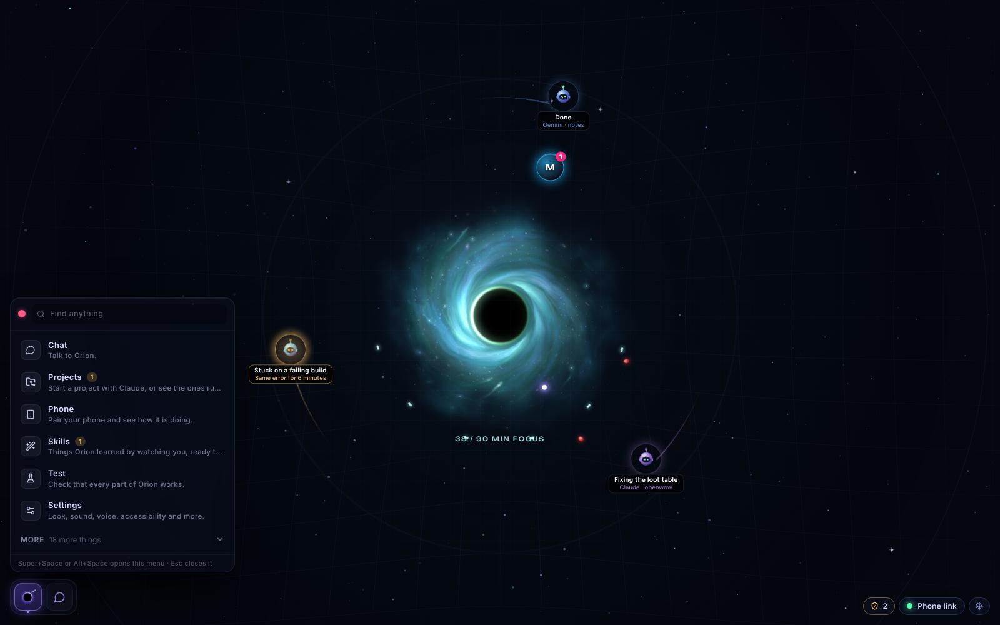
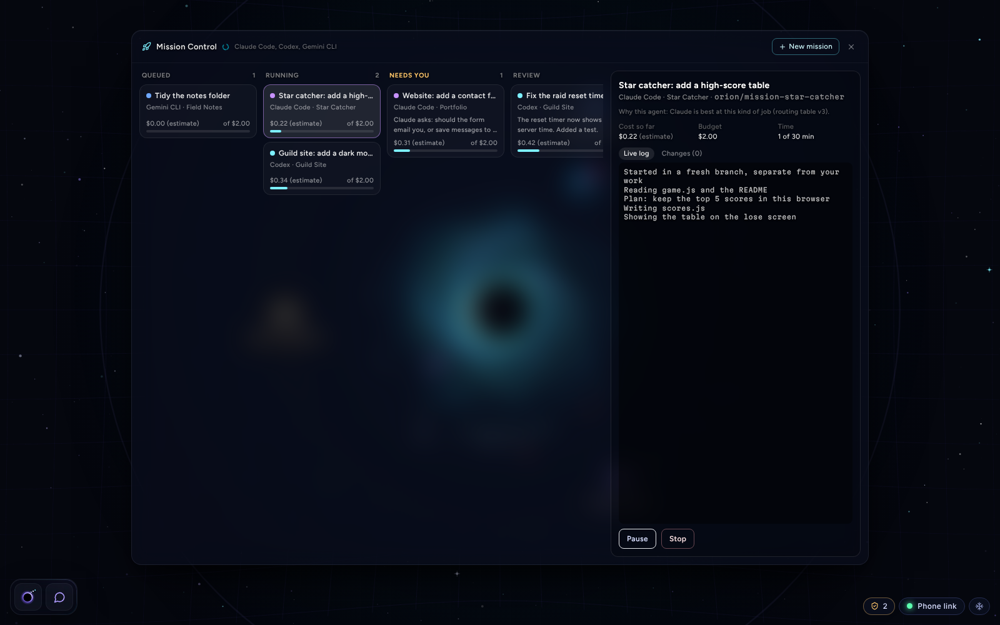
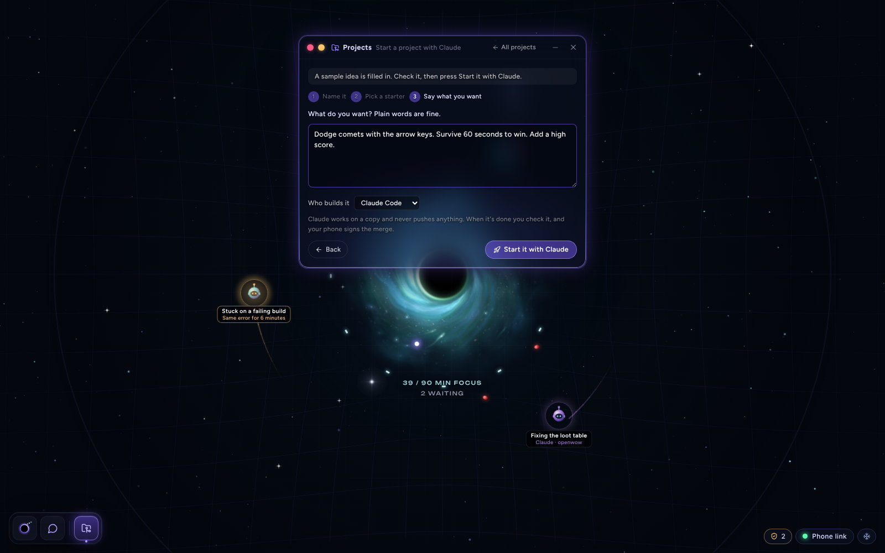
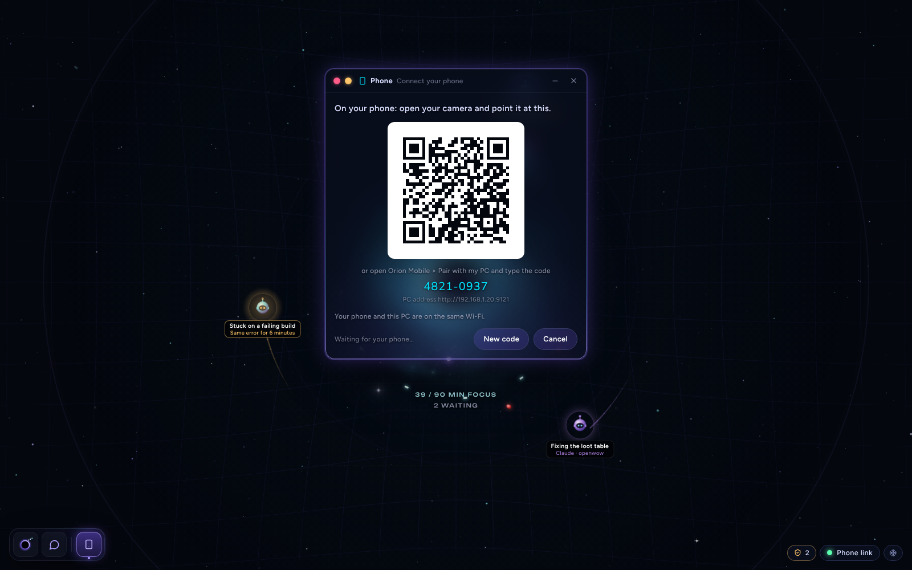
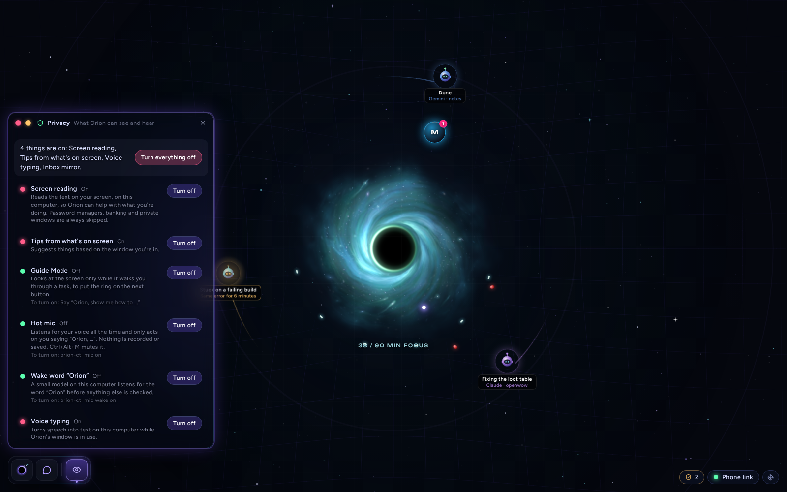
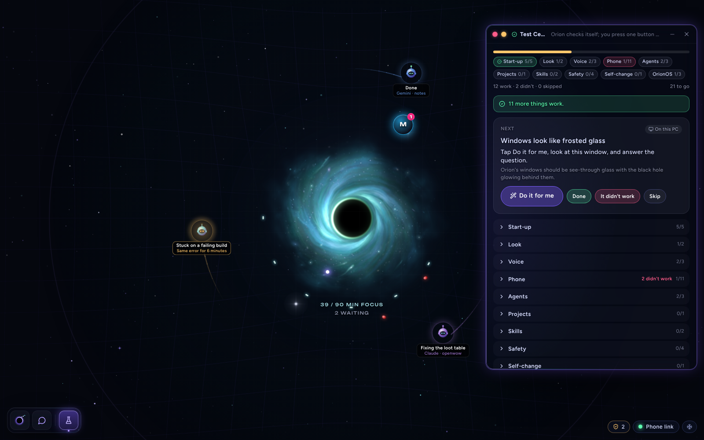
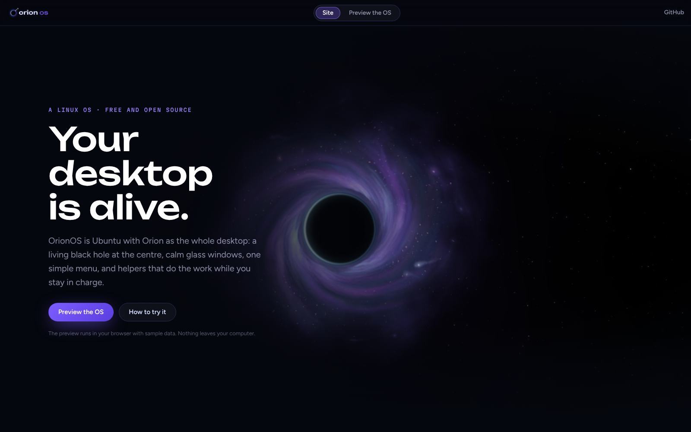

# OrionOS

**One calm desktop for your work, your messages, your agents and your phone, and you stay in charge of all of it.**

Orion is a local-first desktop companion. You can talk to it any time, it keeps your agents, messages, files and
projects in one place, and it pairs with your phone, so approvals happen with your fingerprint. It comes in two
forms:

- **Orion on Windows:** a desktop window plus a small background service. Double-click and go.
- **OrionOS:** a full Linux system (Ubuntu 24.04 + SwayFX) built around Orion. Try it in a virtual machine, run it
  from a USB stick, install it next to Windows, or install it instead of Windows.

**[Try the live preview in your browser](https://orionopenwow.github.io/OrionOS/#preview)**: the real desktop with
sample data. Nothing leaves your browser.



> **Status:** early and moving fast. OrionOS has been tested in virtual machines; real-hardware installs are still
> being tested. Back up anything important before you install it on a real disk.

---

## What it does

| | |
|---|---|
| **One menu** | Every window (Projects, Mission Control, Phone, Privacy, Test Center, Games and more) opens from one menu. No clutter. |
| **Projects** | Start a project (an app, a website, a game) from a template, and hand the work to agents. |
| **Mission Control** | Watch agents work live, review what they changed, and merge it when you're happy. Merging needs your fingerprint. |
| **Your phone, paired** | Scan a QR code once. After that your phone gets alerts, sends missions, and approves things with your fingerprint. The link heals itself after restarts, Wi-Fi changes and sleep. |
| **Privacy first** | Camera and microphone are off by default. One screen shows every sensor and turns any of them off. |
| **Voice** | Talk to Orion with a wake word or a hotkey. Speech is turned into text on your own computer. |
| **Guide Mode** | Ask how to do something, and Orion highlights each button on screen, one step at a time. |
| **Skills** | Show Orion a task once, and it can repeat it. |
| **Self-changes** | Orion can improve its own code. Each change is built in a copy, tested, shown as a preview, and only goes live after you approve it. |
| **Games** | Finds the games you already own (Steam, Epic, Battle.net, World of Warcraft) and sets up the right launcher in one click. |
| **Bring my stuff** | Moving from Windows? A kit carries over your files, Wi-Fi networks, most-used apps, bookmarks, extension list and Tampermonkey scripts. Passwords and cookies are never copied. |
| **Start Here + Test Center** | A step-by-step wizard sets everything up, and the Test Center checks that each part works, with a "Do it for me" button. |

<table>
<tr>
<td><br><b>Mission Control</b>: agents at work, each change waiting for your review</td>
<td><br><b>Projects</b>: start an app, site or game from a template</td>
</tr>
<tr>
<td><br><b>Phone</b>: pair once with a QR code</td>
<td><br><b>Privacy</b>: every sensor in one place, off by default</td>
</tr>
<tr>
<td><br><b>Test Center</b>: checks every part, and fixes what it can</td>
<td><br><b>The website</b>: features, commands and the live preview</td>
</tr>
</table>

## You stay in charge

- **Nothing is sent on your behalf without your tap.** Orion drafts messages and waits for you.
- **Big actions need your fingerprint** on the paired phone: anything public, irreversible, involving money or
  secrets, and changes to Orion's own core.
- **Your phone can only read, unless you approve.** It holds two keys: a read key for everyday use, and a
  signing key that is unlocked only by your fingerprint.
- **Secret Shield** checks every commit, so keys and passwords never reach a repository.
- **Local first.** Your data stays on your computer. Cloud AI services are optional, and you add the keys.

## Get started

### On Windows

1. Download or clone this repository.
2. Double-click **`Start Here.cmd`**. It walks you through each step with simple yes/no questions: installing what's
   needed, starting Orion, pairing your phone and running the tests.
3. Afterwards, **`Start Orion.cmd`** starts Orion.

### OrionOS (virtual machine, USB, or installing it)

See **[docs/install/](docs/install/README.md)**. It covers:
- trying it in a virtual machine;
- making a USB stick;
- installing next to Windows;
- installing on its own.

### Phone

The Android app lives in `apps/mobile`. See **[docs/ORION_PHONE_GUIDE.md](docs/ORION_PHONE_GUIDE.md)** to install it
and pair it.

## For developers

**What's in this repo**

```
apps/daemon     the background service (Python, FastAPI), port 9120; the phone talks to port 9121
apps/desktop    the desktop window and HUD (Tauri + React + TypeScript)
apps/mobile     the Android app (Kotlin, no third-party libraries)
os/             OrionOS: the image build, installer, desktop, settings, rescue and Windows helpers
docs/           guides and plans; docs/index.html is the website, docs/app is the live preview
scripts/        build, test, Secret Shield and website tools
```

**Requirements:** Node 20+ (CI uses 22), Python 3.10+ (CI uses 3.12), and Rust for the desktop build. Copy
`apps/daemon/.env.example` to `apps/daemon/.env` and fill in only the keys you want. Every key is optional.

**Run the tests**

```bash
npm ci
cd apps/daemon && python -m pytest -q        # the background service
python -m pytest -q os/*/tests               # OrionOS (run from the repo root)
npm run typecheck                            # the desktop window
npm test -w @orion/desktop
npm run test:demo-smoke -w @orion/desktop    # opens every window in the live preview (needs Playwright)
```

**Website:** `node scripts/update-site.mjs` refreshes the website's command lists from the code, and
`node scripts/capture-screenshots.mjs` re-takes the pictures. Pushing to `main` publishes the site with GitHub
Actions.

More docs:
- [docs/TESTING.md](docs/TESTING.md): the full test run.
- [docs/DESKTOP_APP.md](docs/DESKTOP_APP.md): the desktop app and its updates.
- [docs/FEATURE_BIBLE.md](docs/FEATURE_BIBLE.md): every feature.
- [docs/research/](docs/research/): the roadmap research, including the Android plan.

## Credits and licences

- OrionOS is under the **[MIT licence](LICENSE)**.
- Bundled fonts are under the SIL Open Font Licence, with their licences next to them.
- Some artwork is AI-generated and carries content credentials that say so.
- The OpenWoW tools never include game files. Players supply their own.

## Security

Found a security problem? Please report it privately. See **[SECURITY.md](SECURITY.md)**.
