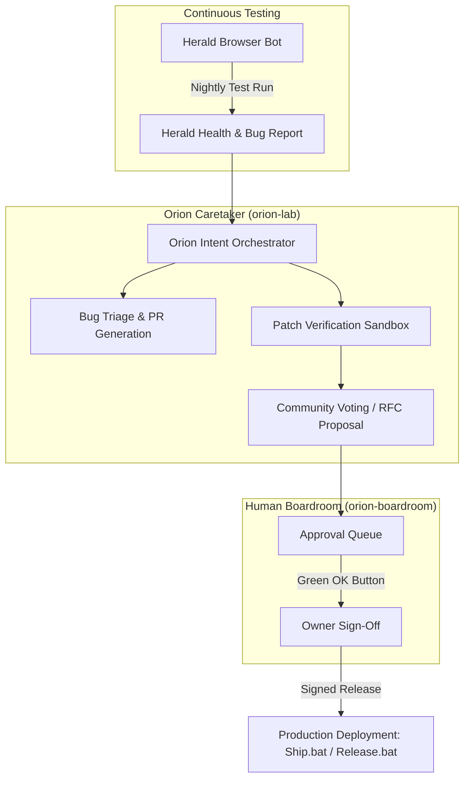

# OpenWoW — Vanilla Remastered

> **The Core Idea:** A free, open-source home for World of Warcraft 1.12 that anyone can play straight from a browser, plus everything needed to mod it, host it, and grow a community around it.
> **The Pitch:** *"Vanilla Remastered"* — the classic game preserved with modern conveniences and original new content, not a cash grab. Currently in private alpha with Discord testers.

---

## 1. Ways to Play

Players bring their own 1.12 game files; OpenWoW never ships or modifies proprietary assets.

| Mode | Platform & Stack | Description |
|---|---|---|
| **Browser Client** | WebGPU / Rust (`wenilla` engine, based on `benilla`) | Full client rendered directly in a web tab on desktop or WebGPU-capable mobile devices. Can be installed as a PWA (Progressive Web App) to the home screen. |
| **Desktop Launcher** | `OpenWoW.exe` (Tauri / Native) | Selects realm and runtime engine (OpenWoW WebGPU, in-browser, or stock 1.12 `WoW.exe`). Automatically configures `realmlist.wtf`, performs self-updates, manages addon installations, and includes a built-in Support page. |
| **Solo / Offline** | SPP Classics (CMaNGOS + Playerbots) | Built-in one-click launcher installation of local CMaNGOS with intelligent playerbots for offline progression without an internet connection. |
| **Host Your Own** | Peer-to-Peer / Dedicated Server | Two options directly from the launcher's **HOST** tab: • **Host for Friends:** Zero-config peer-to-peer invite link sharing. • **Dedicated Server:** Full standalone realm setup including companion website and Server Studio management dashboard. |

---

## 2. Authentication & Sign-in (v1.16.1)

- **Themed Sign-in Experience:** Atmospheric classic login screen with one-tap Discord OAuth2 integration.
- **Persistent Sessions:** 60-day session tokens with *"Continue as..."* fast-resume for returning players.
- **Free Guest Accounts:** Jump into the game instantly with zero friction or email registration. Guest progress and characters can be linked to a Discord account later with complete state preservation.

---

## 3. Classic+ Realm Content & Systems

Preserves the vanilla 1.12 combat feel while introducing quality-of-life updates and fresh content:

- **Modern Race & Class Combinations:** Expanded race/class combinations with correctly adapted starting gear sets, stats, and weapon proficiencies.
- **Modern Defaults:** Native auto-looting, instantaneous quest dialogue text, and modernized camera/interface defaults.
- **Stardust Economy:** Unified cosmetic in-game currency. Available from **Vaelis the Starwright**, a cosmic vendor stationed at the Stormwind and Orgrimmar banks.
- **Quality-of-Life Realm Upgrades:**
  - Auto-learned abilities and spells as characters level up.
  - Free talent respecs and dual-spec talent switching.
  - Hunter starter pet given upon character creation.
  - AoE area corpse looting.
  - Smoothed, gentler leveling curve.
  - Built-in achievement tracking engine (388 vanilla achievements).
  - Authentic WoW-style loading screen and class-grid visual fixes.

---

## 4. Addon Suite (Modular & Switchable)

All addons are active by default with authentic vanilla styling, and can be toggled on or off individually:

| Domain | Addons | Capabilities |
|---|---|---|
| **Combat & Raids** | `Meters`, `Threat`, `Casting`, `Raid`, `Plates` | Details!-grade DPS/HPS breakdowns, threat meters, custom cast bars, raid unit frames, and floating nameplates. |
| **Questing & Map** | `Quests` | Minimap quest tracker ring, POI pins, searchable quest log, and corpse retrieval arrow. |
| **Economy & Items** | `Bags`, `Prices`, `Vendor`, `Mail`, `Loot` | Unified bag views with equipment sets, vendor price indicators, auto-repair/sell junk, batch mailing, and roll tracking. |
| **Social & Guilds** | `Social`, `Guilds`, `Guild Hub`, `Chat`, `Dungeons` | Guild management with rosters, event calendar, DKP tracking, loot council tools, chat channel tab themes, history logging, spam filtering, and an LFG group-finder board. |
| **Character & Identity** | `Persona`, `Talents`, `Achievements` | Roleplay profiles with character artwork, talent tree planner, and 388 vanilla achievements. |
| **Utilities** | `Essentials` | Cooldown timers, spell range color indicators, quick keybind configuration mode, and accessibility accommodations. |

---

## 5. Community & Moderation

- **Discord World Chat Bridge:** Real-time two-way sync between in-game world chat channels and community Discord channels.
- **Context-Aware Moderation Desk:** Player reports capture full preceding and succeeding chat context. All account actions and bans are reviewed and decided by human moderators.
- **Streamer Visibility:** Integrated `● LIVE` badge indicators for approved content creators actively broadcasting.

---

## 6. Website & Creator Tools

- **Armory:** Complete character and guild inspection engine with public/private visibility toggles.
- **Creators & Streamers Hub:** Community showcase with monthly leaderboard tracking.
- **The Workshop:** Community mod marketplace for discovering, rating, and installing addons, skins, and repacks with creator attribution.
- **Guides & Solo Play:** Documentation, client guides, and offline setup tutorials.
- **Non-P2W Tip Jar:** Strict project mandate: tips and contributions **never** buy player power, items, stats, or game time.
- **The Model Porter:** Creator studio tool. Drag-and-drop a rigged `.glb` model or modern `.m2` asset to convert it into a 1.12 creature or rideable mount complete with skeleton, animations, textures, interactive 3D preview, and one-click *"Add to OpenWoW"*.

---

## 7. Operations & Automated Testing

- **Continuous Deployment Pipeline:**
  - `Ship.bat` (package and stage changes)
  - `Release.bat` (sign and tag release)
  - Realm container image rebuild.
  - Web and addon updates go live within ~60 seconds of a git push.
- **Herald (The Nightly Test Bot):** An automated Human Hunter that logs into a live realm nightly inside a headless browser session, walks through questing, pathfinding, combat, and inventory routines, and reports operational health.
- **Herald Lite:** Fast pre-flight test runner executing on staging before any update reaches live production.

---

## 8. Orion & OrionOS: The Realm's Caretaker

Orion serves as the autonomous AI maintainer and operational co-pilot for OpenWoW:

### The Caretaker Responsibilities
1. **Herald Report Ingestion:** Parses Herald and Herald Lite automated playtest logs, isolates regressions, and pins down failing game coordinates or packets.
2. **Bug Queue Triage:** Classifies community bug tickets from Discord and GitHub with severity tags (P0-P3), extracting reproduction steps and offending DBC/SQL IDs.
3. **Patch Verification:** Builds test patches against sandboxed CMaNGOS / Benilla worktrees, running automated unit and integration tests.
4. **Community Voting & RFCs:** Drafts prospective balance or feature updates for transparent community voting before submission to the owner.
5. **The "Green OK Button" Principle:** Orion operates with earned autonomy, but **never signs off on its own work**. All production deployments, code merges, monetary allocations, and player bans require explicit sign-off from the owner via the isolated Boardroom console.
