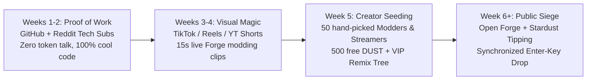

# Orion Social Media & Creator Outreach Master Plan

> **Core Rule Compliance:** Strictly enforces `[no-messaging]` (*"Never send a message, post or reply to anyone on the owner's behalf. Draft it and put it in the approval queue instead"*) and `[approval-rules]`.
> **How It Works:** Orion does 99% of the heavy lifting — researching creators, writing human-grade scripts/posts, stripping AI clichés, and queuing payloads. **You are the final green button:** you review the live queue and hit `Enter` inside `Publish Approved Posts.cmd` (`scripts/publish-approved.mjs`) to commit and schedule an entire batch at once.

---

## 1. The Anti-AI Copywriting System ("Never Sound Like a Bot")

Most AI posts fail immediately because people smell ChatGPT syntax in half a second. Orion's `outreach_engine.py` runs every draft through a **Human Voice Filter** before it ever reaches your approval queue.

### A. Hard-Banned AI Words & Patterns (Auto-Stripped)
- **Banned Words:** *delve, tapestry, testament, game-changer, revolutionary, unleash, unlock, elevate, realm (outside WoW context), symphony, beacon, landscape, seamless, paradigm, buckle up, dive in, supercharge, groundbreaking.*
- **Banned Structures:**
  - Starting a post with a rhetorical question (*"Ever wondered how to mod games faster?"*)
  - Three-adjective lists (*"fast, intuitive, and revolutionary"*)
  - Fake corporate enthusiasm + rocket/fire emoji spam (`🚀🔥✨`)
  - Symmetrical "In conclusion / Overall" wrap-ups
  - Overuse of em-dashes (`—`) in every single sentence

### B. What Works Instead (Indie Builder / GitHub Devlog Voice)
1. **Start in the middle of what you built:** *"I bound F9 to a local window over WoW 1.12, typed 'make my target frame shake when execute is ready', and it wrote the Lua and reloaded in 6 seconds."*
2. **Include one real flaw or concrete number:** *"It broke on multiline XML the first three tries until I forced single-file output. Costs about 3 cents of compute."* (Specific numbers and admitted bugs prove a human wrote it.)
3. **Lowercase / casual punctuation for short-form & Discord:** Real devs don't capitalize every header in a quick update.
4. **Show the revert button:** Gamers hate tools that brick their install. Showing `git reset --hard HEAD~1` undoing a broken mod in 1 second sells the tool better than any pitch.

---

## 2. Target Creator Categories & Outreach Lists

Orion organizes outreach into five high-conversion tiers (stored and managed in `apps/daemon/outreach_engine.py`):

| Tier | Niche | Platforms | Why They Care | Hook Angle |
|---|---|---|---|---|
| **Tier 1: Game Modding & Decomp/Sandboxes** | Skyrim, Balatro, Minecraft, RimWorld, Terraria, Factorio modders | YouTube, TikTok, Reddit (`r/skyrimmods`, `r/balatro`) | They spend hours debugging boilerplate Lua/C#/JSON. | *"Press a hotkey in-game, describe the mod, it commits to git and reloads. And if someone forks your mod, you get 25% of the Stardust automatically."* |
| **Tier 2: Classic / Vanilla MMO & Private Server Creators** | Classic WoW 1.12 / 3.3.5a, Turtle WoW, Epoch, OSRS creators | YouTube, Twitch, Discord, Reddit (`r/wowservers`, `r/classicwow`) | They love Vanilla Remastered, browser WebGPU WoW (`wenilla`), and custom `.glb` → `.m2` mounts. | *"We got 1.12 running inside a browser tab on WebGPU + a drag-and-drop Blender `.glb` to `.m2` mount porter."* |
| **Tier 3: Local AI, Open-Source & Linux Rice Builders** | LocalLLaMA, homelab, Wayland/SwayFX, Tauri/Rust devs | Reddit (`r/LocalLLaMA`, `r/unixporn`, `r/rust`), YouTube, X | They love bootable custom OSes (`OrionOS`), local Ollama routing, and two-VM hardware isolation. | *"Built a bootable Ubuntu/SwayFX USB OS where the AI runs in one VM with zero keys, and a second air-gapped VM signs approvals."* |
| **Tier 4: Short-Form "Build in Public" Tech Reels/TikTok** | Indie hackers, shader programmers, Three.js / WebGPU showcase accounts | TikTok, Instagram Reels, YouTube Shorts | Visual spectacle: the cosmic portal HUD, floating voice kinetic text, and live in-game modding. | 15-second screen capture: speak into mic → floating text appears → game reloads with a brand-new boss mechanic. |
| **Tier 5: Indie Game Devs (Bevy, Godot, Three.js, WebGL)** | Solo devs on itch.io, GitHub trending game repos | Email, GitHub Discussions, Discord | They need monetization and mod support without building backend servers. | *"Drop 3 lines of `window.orion` into your game and you get an instant mod loader + creator tip jar."* |

---

## 3. The 6-Week Slow Rollout Schedule

Never blast all platforms on Day 1. A slow, staged rollout builds social proof so that when bigger creators click your profile, they see real code, real commits, and active testers.



| Week | Phase | Cadence | Goal |
|---|---|---|---|
| **Week 1** | **Technical Proof (Code First)** | 2 Reddit posts (`r/LocalLLaMA`, `r/rust`), 3 short raw screen recordings | Show the OrionOS dual-VM architecture (`orion-lab` + `orion-boardroom`) and WebGPU browser client. Zero crypto talk. |
| **Week 2** | **The Forge Trick** | 3 TikTok/Reels/Shorts clips (15–25s each), 1 YouTube 4-min walkthrough | Show live voice-to-mod in WoW 1.12 and Balatro + the 1-click `git reset` revert button. |
| **Week 3** | **The Model Porter** | 3 TikTok/Reels clips, 1 `r/gamedev` / `r/wowservers` post | Dragging a `.glb` file into Orion and riding it as a mount inside 1.12 thirty seconds later. |
| **Week 4** | **Creator Seeding (Private DM/Email Batch 1)** | 5 curated creator emails per day (approved via CLI) | Give 25 modders/streamers early access + 500 free Stardust credits so they record their own clips. |
| **Week 5** | **The Remix Tree & Tipping** | 4 short-form videos + Discord community showcase | Show how forking a mod automatically pays 25% Stardust back to the original modder. |
| **Week 6** | **Coordinated Public Launch** | Synchronized multi-platform batch via `Publish Approved Posts.cmd` | Open public access to OrionOS USB image, Forge, and Stardust creator tipping. |

---

## 4. Real-Time Ready-to-Post Copy Examples (Human-Toned)

These templates are pre-loaded into `apps/daemon/outreach_engine.py` and ready to queue:

### Example 1 — TikTok / Instagram Reels / YouTube Shorts (18 seconds)
- **Visual Hook (0–3s):** Split screen: WoW 1.12 running on the left, Orion cosmic orb floating on the right. No face cam needed — just clean desktop audio.
- **Spoken / On-Screen Text (3–10s):** *"got tired of writing Lua boilerplate for 1.12 addons, so i hooked a local hotkey up to a git-backed mod folder."*
- **Action (10–15s):** Click Orion, say *"make a small frame that tracks my mana ticks and flashes purple when five-second rule ends."* Floating kinetic text appears, file commits, type `/reload`.
- **Payoff (15–18s):** The mana tick bar works immediately.
- **Caption:** `bound a hotkey over 1.12 that writes and commits lua addons into their own git repo so if it hallucinates i just hit revert. took 4 tries to stop it from writing xml files lol. link in bio if you want the adapter.`

### Example 2 — Reddit (`r/LocalLLaMA` or `r/gamedev`)
- **Title:** `I built a two-VM Linux setup (OrionOS) where my local agent runs in one VM with zero keys, and a second "boardroom" VM signs off on actions`
- **Body:**
  > I've been working on a desktop agent + custom Ubuntu/SwayFX image called OrionOS, and the main thing that always bugged me about autonomous agents is giving them API keys, git push rights, or wallet access on the same machine they execute code on.
  >
  > So I split it into two VirtualBox/KVM machines over Tailscale:
  > - `orion-lab`: boots straight into the HUD, runs the Python daemon, Ollama router, and rootless Docker sandboxes. Has zero private keys and a per-user `nftables` firewall that only lets traffic out through a local Squid allow-list.
  > - `orion-boardroom`: stripped-down console with no browser. Holds the single `ed25519` signing key.
  >
  > When the lab wants to spend compute credits (we call them Stardust), merge a patch, or run a game mod script, it sends a canonical JSON packet hash to the boardroom. I approve one "Fuel Tank" session receipt for 2 hours and let it cook.
  >
  > Repo and `.vdi` build scripts are open if anyone wants to poke holes in the firewall rules.

### Example 3 — Creator Outreach Email / DM (Short, Zero Fluff)
- **Subject:** `quick tool for your [Game Name] mods (auto-splits tips when people fork your work)`
- **Body:**
  > hey [Creator Name] — watched your video on [specific mod/video topic].
  >
  > built an open-source overlay called Orion Forge that lets players remix Lua/config mods in-game with a hotkey, and every mod carries a `forge.json` file with the original author's ID.
  >
  > whenever someone remixes or tips a mod built on top of yours, the ledger automatically sends 25% of the Stardust credits straight to you (which you can use for AI compute, 3D model porting, or cash out once payout gates open).
  >
  > loaded an account with 1,000 free Stardust for you if you ever want to mess with it — no strings attached, don't have to post about it unless you actually like it. want me to send the invite link?

### Example 4 — Discord Server Update (Safe & Compliant)
- **Header:** `*[Orion — Automated Realm Caretaker]*`
- **Body:**
  > **Nightly Herald Report + Forge Build 1.0.4**
  > - Herald finished the 03:00 Elwynn pathfinding run (0 crashes, 14 quests verified).
  > - Model Porter now fixes inverted normals on `.glb` mounts before writing `.m2` bones.
  > - 3 new community addons are up in the Workshop. Remember: if you fork someone's addon in Forge, keep their `parent_mod_id` in `forge.json` so they get their 25% cut.

---

## 5. Discord & Platform Anti-Ban Protection Rules

Trying to fake a human browser session ("self-botting") on Discord or Reddit gets accounts permanently banned within days. Instead, Orion protects your accounts using **legitimate, un-bannable architecture**:

1. **Official Webhooks & Bot Tokens for Discord:**
   - Never automate a personal user token. Use official Discord Channel Webhooks or an official Bot Application token.
   - Per `NEXT_PASS_PLAN.md` §1, Orion identifies clearly as **Orion (AI Caretaker)** — Discord explicitly allows automated bots and webhooks when they use the official API and respect rate limits.
2. **Jittered Human-Paced Scheduling (`publish-approved.mjs`):**
   - Even after you hit `Enter` to approve 10 posts at once, the publisher does **not** fire 10 HTTP requests in the same millisecond.
   - It spaces dispatches out with **randomized human jitter** (e.g., `45s–180s` between Discord/webhook posts, and staggered optimal time slots for TikTok/Reels/YouTube/Reddit) and enforces exponential backoff on HTTP `429 Too Many Requests`.
3. **Clipboard + Native Studio Handoff for TikTok / Reels:**
   - TikTok and Instagram aggressively shadowban third-party unofficial upload bots.
   - For TikTok/Reels, `publish-approved.mjs` either calls the official **TikTok Content Posting API / YouTube Data API v3** (if configured) OR opens the exact upload page with the caption copied to your clipboard and the rendered video highlighted so you click one native button with 100% full organic reach.

---

## 6. How to Run the One-Key Approval & Publishing Script

1. **Generate & Queue Drafts (Via Daemon API or CLI):**
   ```powershell
   node scripts/publish-approved.mjs --seed
   ```
   This seeds the initial slow-rollout campaign and creator outreach drafts into Orion's Approval Queue (`~/.orion/approvals.json`).

2. **Step Through & Hit `Enter` to Approve & Schedule:**
   Double-click **`Publish Approved Posts.cmd`** or run:
   ```powershell
   node scripts/publish-approved.mjs
   ```
   For each queued post, Orion shows:
   - Platform (`tiktok`, `reels`, `youtube`, `reddit`, `discord`, `creator_email`)
   - Human Voice Score (verifying zero AI buzzwords)
   - Scheduled timestamp & jitter window
   - Full copy & media path
   - Prompt: **`[Enter = Approve & Schedule]  [s = Skip]  [r = Reject]`**
