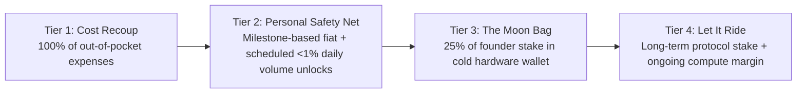

# Stardust (`$DUST`) — Complete Architecture, Tokenomics, Forge Modding & Creator Roadmap

> **Status:** Active post-OrionOS 1.0 build plan.
> **Core Rule Alignment:** Follows `[approval-rules]`, `[no-secrets]`, and `[plans-are-truth]`. `orion-lab` proposes; `orion-boardroom` signs. No private keys ever sit on an agent VM.

**One line:** Stardust (`$DUST`) is the universal compute and creator fuel inside OrionOS. It powers **Forge** (allowing anyone to mod games, inspect game formats in a clean room, and generate assets on their PC), automatically splits royalties and tips to creators across every game project, and scales from zero-cost off-chain credits into an audited utility token.

---

## 1. What Stardust Powers

| Mode in OrionOS | What the User Does | What Stardust Pays For |
|---|---|---|
| **Forge (Game Modding & Clean-Room Inspector)** | Press a hotkey over a running game, describe a mod or UI change in plain words, and Orion inspects the game's documented API/error log, writes the mod into a git-tracked folder, and reloads it live. | Model tokens (code, textures, audio, 3D `.glb` → `.m2` conversion) + automatic royalty split to any parent modder whose work you forked. |
| **Creator Tipping & Cross-Game Bounties** | Click **[⚡ Tip Creator]** on any mod, addon, repack, or custom game across the Orion network, or fund a bounty for a feature you want built. | 97% goes straight to the creator's Stardust balance (usable in any other game project or cashable at payout gates); 3% burns/re-funds the compute pool. |
| **Assistant & Battle Stations** | Talk to Orion, run multi-agent coding tasks, automate desktop workflows. | Metered frontier AI calls (Claude, Gemini, GPT) via the Compute Gatekeeper without needing five separate monthly subscriptions. |
| **Arcade & `window.orion` SDK** | Indie devs drop 3 lines of `window.orion` into their own game to add AI NPCs, dynamic item forging, or a mod shop. | Per-call AI generation and creator store splits. |

---

## 2. How Forge Mods & Inspects Games Safely on Any PC

Forge turns natural language into working mods without touching closed binaries, kernel drivers, or anti-cheat:

1. **Clean-Room Game Adapters (`game-adapters/<game>/`)**:
   - Instead of illegal binary patching or DLL injection, Forge uses **Adapter Packs** containing:
     - `game_context.md`: Documented Lua/JS/C#/config APIs, event hooks, and data table schemas (~3,000 tokens).
     - `inspector.py`: Reads public game directories (addon folders, `.toc` manifests, public DBC/CSV schemas, crash/error logs like `Logs/FrameXML.log`).
     - `template/`: A known-good starter mod so the AI outputs a single self-contained file that loads on the first try.
2. **Git-Backed Sandbox (`OrionForge_<ModName>/`)**:
   - Every prompt creates a git commit inside the mod's folder.
   - If a generated mod breaks or looks wrong, **Revert** runs `git reset --hard HEAD~1` and reloads cleanly in one second.
3. **Self-Healing Error Watcher**:
   - Orion tails the game's error log in real time. If a mod throws a runtime error, a small floating prompt appears above Orion: *"Lua error on line 42 — Fix it (≈2 DUST)?"*
4. **The Fuel Tank (One Approval Per Session)**:
   - Spending is a money action (`[approval-rules]`). Instead of nagging you on every prompt, you sign **one Fuel Tank receipt** in the boardroom at the start of a session (e.g., *"Allow up to 100 DUST for Forge over the next 2 hours"*).
   - `orion-lab` spends from that tank until it expires or runs dry. No mod or game can ever raise its own cap.

---

## 3. Automatic Creator Tipping & Royalty Splits

Every mod created or remixed in Forge carries a `forge.json` manifest recording its lineage:

```json
{
  "mod_id": "mod-cosmic-meters-v2",
  "title": "Cosmic Damage Meters",
  "game": "openwow-112",
  "author": "creator_alice",
  "parent_mod_id": "mod-classic-meters-v1",
  "original_author": "creator_bob",
  "asset_authors": ["artist_carol"]
}
```

### A. Fork & Remix Royalty Split (Automatic on Every Paid Remix / Store Spend)
Whenever someone spends Stardust to fork, remix, or buy an AI-enhanced mod, the ledger splits the Stardust atomically:
- **60%** → Active Remixer / Mod Author (`creator_alice`)
- **25%** → Original Root Modder (`creator_bob`)
- **10%** → Asset / Model / Shader Creator (`artist_carol`)
- **5%** → Protocol Burn / Compute Reserve Sink

### B. Direct Creator Tipping (`dust.tip`)
Creators across completely different games (e.g., a Balatro modder, a WoW 1.12 addon author, a Bevy indie dev) share the same Stardust network:
- **97%** → Credited immediately to the recipient creator's balance.
- **3%** → Protocol Burn / Compute Reserve Sink.
- Creators can immediately spend received tips to fuel Orion on their own game projects, hire bounty hunters, or request a boardroom-signed payout.

---

## 4. Complete Tokenomics (`1,000,000,000 $DUST`)

### Supply & Utility Anchor
- **Ticker:** `$DUST` (Stardust)
- **Total Fixed Supply:** `1,000,000,000 DUST` (1 Billion — hard-capped, zero inflation beyond genesis).
- **Compute Peg Floor (Phase 0–1 Reference):** `100 DUST ≈ $1.00 USD` of metered AI compute (`1 DUST = $0.01`). Even if market price fluctuates later in Phase 3, the Compute Gatekeeper adjusts the DUST-per-1k-token oracle rate so modders always get predictable prompt costs.

### Allocation Table

| Bucket | % of Supply | Tokens (`DUST`) | Vesting & Unlock Schedule | Purpose |
|---|---|---|---|---|
| **1. Creator, Modder & Playtest Rewards** | **40%** | `400,000,000` | Emitted over 48 months based on verified mod usage, forks, and Herald bug bounties | Rewards the builders who make mods, adapters, and 3D assets. |
| **2. Compute & Ecosystem Treasury** | **25%** | `250,000,000` | Locked in multisig; max 2% per month unlocked only by signed Boardroom verdict | Subsidizes API compute credits, server hosting, and cross-game grants. |
| **3. Founder / Creator Allocation** | **15%** | `150,000,000` | **Cost-Recoup Tranche** (up to 10% of bucket at TGE/liquidity gates) + **12-month cliff, 36-month linear vest** | Compensates the creator across structured safety-net milestones, moon bag, and long-term ride. |
| **4. Community Airdrop & Early Testers** | **10%** | `100,000,000` | 50% unlocked at Phase 3 launch via Merkle proof; 50% vested over 6 months of active usage | Rewards Phase 0–2 alpha testers, Discord bug hunters, and early Forge modders. |
| **5. Liquidity & Exchange Reserves** | **10%** | `100,000,000` | Paired with protocol-owned liquidity (LP tokens locked 24 months) | Ensures healthy DEX depth on Base without relying on predatory market makers. |

### Deflationary Sinks (Why `$DUST` Has Structural Demand)
1. **Prompt & Forge Burn:** 5% of every Forge remix fee and 20% of raw Compute Gatekeeper margin is permanently burned.
2. **Tip & Marketplace Burn:** 3% of direct creator tips and Workshop marketplace trades is burned.
3. **Bounty Slash Burn:** If a malicious mod fails sandbox verification, 50% of its publisher bond goes to the bug reporter and 50% is burned.

---

## 5. Low-Budget "Siege" Strategy (Bootstrap with Almost Zero Capital)

You do **not** need $50,000 for liquidity, auditors, or paid ads on Day 1. You siege the market in four lean steps:

1. **Zero-Gas Day 1 (SQLite Ledger in `orion-boardroom`)**:
   - Launch Stardust as **off-chain credits** inside OrionOS and the web demo (`apps/daemon/stardust.py`). Cost to deploy: **$0**.
   - Every new user gets **50 Free Trial DUST** funded by **local Ollama models** (which cost you $0.00 in API fees) plus a tiny capped cloud allowance.
2. **Self-Funding Compute Margin**:
   - When power users top up $5 or $10 via Stripe/Ko-fi for heavy Claude/Gemini modding sessions, the Compute Gatekeeper charges a **20% compute convenience margin** ($1.00 of API cost = 120 DUST).
   - Every 5 users paying $10 covers $40 in API costs and puts **$10 pure cash** into your Cost Recoup & Audit fund.
3. **Every Mod is a Trojan Horse Advertisement**:
   - Every addon/mod generated by Forge automatically includes a clean header comment and optional subtle loading tag:
     `-- Built in 30s with Orion Forge. Remix this mod: orion-os.dev`
   - When a streamer or YouTuber shows a cool custom mod in WoW, Balatro, or Skyrim, viewers ask *"How did you make that?"* — the mod itself brings the next wave of users for free.
4. **Open-Source Adapter Bounties Paid in Future Airdrop Points**:
   - Instead of paying cash to support 20 games, offer **Stardust Genesis Points** (tracked in `dust_events`) to community coders who submit a `game_context.md` adapter for their favorite game (Terraria, Minecraft, Roblox, RimWorld, Stardew Valley).

---

## 6. Creator Financial Plan: Recoup, Safety Net, Moon Bag & Let-It-Ride

The biggest mistake founders make is either never paying themselves (burning out) or dumping tokens on a thin chart (destroying trust and inviting legal trouble). Here is the structured, transparent 4-tier financial plan:



### Tier 1 — Immediate Cost Recoup (Phase 0 & Phase 1 — Fiat First)
- **How it works:** Before any token even exists, the **20% Compute Gatekeeper margin** and **Support Tip Jar** first reimburse 100% of your logged out-of-pocket costs (domains, VPS hosting, API seed money, hardware).
- **Ledger Tracking:** Recorded transparently in `stardust.py` as `founder_expense_reimbursement`. Reimbursing actual business expenses is standard accounting, not a security sale.

### Tier 2 — The Personal Safety Net (Milestones 1, 2 & 3)
Once out-of-pocket costs are paid back, you build a personal financial cushion in two ways:
1. **Ongoing Software & Compute Revenue (Fiat):** As the creator of the Orion Gatekeeper and hosted services, a fixed **15% maintainer share** of net fiat compute/subscription profit goes to you monthly as regular software income.
2. **Milestone Token Unlocks (Phase 3 Mainnet):** Your 15% Founder Allocation (`150,000,000 DUST`) is split into four clear tranches:
   - **Tranche A — Launch Recoup & Tax Buffer (10% of Founder bag = `15,000,000 DUST`):** Unlocks after Phase 3 liquidity reaches $250k+ depth, sold only via an automated **TWAP (Time-Weighted Average Price) rule capped at ≤0.5% of 24h volume per day** so it never moves the price chart.
   - **Tranche B — Safety Net Milestone (`45,000,000 DUST`):** 1-year cliff, then unlocks monthly over 24 months as the ecosystem hits **1,000 active weekly modders**. Goal: lock in your personal 2–3 year living expenses in cash/T-bills so you never operate from financial stress.

### Tier 3 — The Moon Bag (`45,000,000 DUST` — 30% of Founder Bag)
- **How it works:** Vested over years 2–4 and moved to an offline hardware wallet (Ledger/Trezor) that is never connected to daily machines.
- **Rule:** Untouched unless `$DUST` reaches major adoption milestones (e.g., 50,000+ daily active Forge users or major tier-1 ecosystem partnerships), selling no more than 10% of the Moon Bag at each 5x–10x adoption tier.

### Tier 4 — "Let It Ride" (`45,000,000 DUST` — 30% of Founder Bag)
- **How it works:** Permanently aligned with the protocol. Never market-sold. Used only for governance weight, ecosystem liquidity pairing, or long-term protocol yield.

---

## 7. Securities Law Guardrails & When to Airdrop

### How to Stay Safe (The Howey Test & Regulatory Rules)
A token gets flagged as an unregistered security when buyers buy it *expecting profits solely from the managerial efforts of the founder*. To keep `$DUST` on the utility side of the line:
1. **Build Working Utility First (Phases 0 & 1):** When `$DUST` launches on-chain in Phase 3, Forge, the Compute Gatekeeper, and the Workshop marketplace **already work today**. A buyer can immediately spend `$DUST` to generate a mod or tip a creator on minute one.
2. **Never Market `$DUST` as an Investment:**
   - **NEVER say:** *"Buy DUST early before it 100x's"*, *"We're burning tokens to pump the price"*, or *"Passive staking APY"*.
   - **ALWAYS say:** *"Stardust is prepaid compute and creator fuel for OrionOS."*
3. **No Pre-Mine Sales to Retail Before Utility:** Do not sell tokens to the public to "fund development." Sell **software compute credits** in Phase 0–1; only introduce the transferable token after the product is live and a crypto/securities attorney signs off at **Gate 2 → 3**.
4. **Keep Stardust Separate from Third-Party Game IP:** Stardust fuels **OrionOS and the Forge coding engine** (like Cursor or GitHub Copilot for modding). It is **never** sold as World of Warcraft gold or tied to Blizzard/proprietary game database items.

### Exact Airdrop Timing (The 4-Gate Calendar)

| Gate | Timing | Trigger Metric | What Happens |
|---|---|---|---|
| **Phase 0: Genesis Credits** | **Now (Weeks 1–4)** | OrionOS 1.0 built; Forge MVP live on Windows/Linux | Off-chain Stardust ledger tracks every mod created, bug reported, and tip sent. Users earn **Genesis Points**. |
| **Phase 1: Creator Network** | **Weeks 5–10** | 50+ published mods, 10+ creators tipping each other | Lineage tree (`forge.json`) and `window.orion` SDK open to indie devs. |
| **Phase 2: Base Sepolia Testnet** | **Weeks 11–14** | 250+ weekly active Forge users | Deploy `StardustToken.sol` and `ForgeSplitter.sol` to Base Sepolia testnet. Run independent contract audit. |
| **Phase 3: Mainnet & The Airdrop** | **Week 15+ (Only after Audit + Legal OK + 500+ WAU)** | 500+ weekly active modders & $15k+ accumulated in Audit/LP reserve | **TGE & Merkle Airdrop:** Phase 0–2 Genesis Points convert to claimable `$DUST` on Base Mainnet. 50% claimable immediately to use in Forge; 50% unlocks over 6 months of continued modding. |

---

## 8. Implemented Code Reference

| File | Role |
|---|---|
| [`apps/daemon/stardust.py`](../apps/daemon/stardust.py) | Off-chain hash-chained Stardust ledger, Fuel Tank session signer, Compute Gatekeeper metering, 60/25/10/5 Royalty Splitter, 97/3 Creator Tipping, Airdrop Merkle score calculator, and Founder Milestone tracker. |
| [`contracts/StardustToken.sol`](../contracts/StardustToken.sol) | ERC-20 `$DUST` token contract (1B hard cap, burnable, cliff + linear vesting schedule, Merkle airdrop distributor). |
| [`contracts/ForgeSplitter.sol`](../contracts/ForgeSplitter.sol) | On-chain atomic 60/25/10/5 remix royalty splitter and 97/3 direct creator tip router with automatic burn. |
| [`docs/OUTREACH_PLAN.md`](OUTREACH_PLAN.md) | Multi-platform creator outreach, anti-AI human copywriting playbook, slow-rollout schedule, and one-key approval publishing workflow. |
